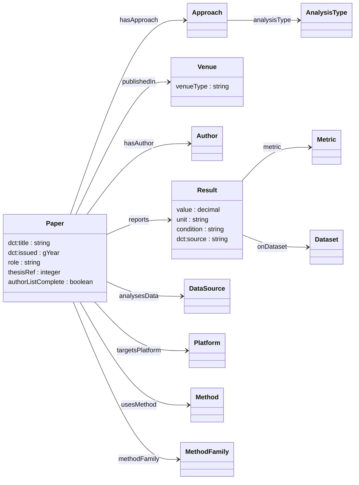

# ransomware-kg

A small knowledge graph of ransomware-detection research, built from the
literature review of my master's thesis. **Phase 1** covers the ontology, the
CSV → RDF pipeline with SHACL validation, a Fuseki triple store and a set of
example SPARQL queries.

## Goal

The literature review compares about twenty papers, along with the results they
report. Spreadsheets are fine for listing them but awkward for questions that
cross several dimensions, such as *"which methods are used on Windows?"* or
*"how does my model compare with DeftPunk on the DeftPunk dataset?"*. The graph
turns the two hand-curated tables into linked, queryable data:

- `data/papers.csv`: one row per paper (authors, venue, approach, data
  sources, platforms, methods, method family, role in the review)
- `data/results.csv`: one row per reported number (metric, value, unit,
  dataset, condition, source table)

Nothing is inferred or invented. Every triple comes from a cell of these two
files.

## Ontology

Namespace `https://w3id.org/rkg#` (`ontology/rkg.ttl`). It reuses Dublin Core
(`dct:title`, `dct:issued`, `dct:source`, `dct:creator`, `dct:isPartOf`), BIBO
(`bibo:Document`), FOAF and schema.org (`Person`, `ScholarlyArticle`,
`Dataset`, `value`, `unitText`).



All entities other than papers and results have exactly one `rdfs:label`.

### Modelling choices

- **URIs** are stable: papers and results use the CSV ids
  (`…/id/paper/kebbas2025`, `…/id/result/kebbas2025-accuracy-deftpunk`).
  Everything else uses a slug of its label (`…/id/method/random-forest`,
  `…/id/platform/windows`), so the same label always gives the same node.
- **Lists** are cells split on `;`. Semicolons inside parentheses are kept,
  so `memory artifacts (processes; DLLs; injections)` stays one data source.
- **"et al."** author lists only produce the named author(s), and the paper is
  marked `rkg:authorListComplete false`.
- **Method family** belongs to the paper, not to the method. Random Forest is
  "ML" in Aljabri et al. but part of a "hybrid" pipeline in ERW-Radar.

### SHACL shapes (`shapes/rkg-shapes.ttl`)

- A Paper has exactly one title, one `xsd:gYear` year, one venue and one role
  from a fixed list, plus at least one author.
- A Result has exactly one Metric, exactly one `xsd:decimal` value, and is
  reported by exactly one Paper. It has at most one dataset.
- An Approach has exactly one AnalysisType (static or dynamic).
- Every named entity has exactly one `rdfs:label`.

`build_graph.py` exits with an error and writes nothing if validation fails.

## How to run

Requirements: Python 3.10+, Docker, `make`, `curl`.

```sh
make build      # CSV -> data/graph.ttl, validated with pySHACL (creates .venv on first run)
make validate   # re-check data/graph.ttl against the shapes
make test       # 3 small pytest checks
make up         # start Fuseki on http://localhost:3030 (TDB2 dataset "rkg", Docker volume)
make load       # PUT ontology + graph into named graphs (idempotent)
make query      # run every query in queries/, or one: make query QUERY=queries/05-*.rq
make down       # stop Fuseki (data kept); `make clean` also deletes the volume
```

Fuseki runs as `secoresearch/fuseki:5.1.0` (Apache Jena Fuseki 5.1.0, built for
both amd64 and arm64) with the service config in `fuseki/rkg.ttl`. The ontology
and the data go into two named graphs, and the default graph is their union, so
queries don't need `GRAPH` clauses. Endpoints:

- SPARQL: `http://localhost:3030/rkg/sparql`
- Graph Store: `http://localhost:3030/rkg/data`
- Admin UI: `http://localhost:3030` (user `admin`, password
  `$FUSEKI_ADMIN_PASSWORD`, default `admin`)

## Queries

| File | Question |
|---|---|
| `01-best-accuracy-per-method-family.rq` | Best reported accuracy per method family |
| `02-dynamic-vs-static.rq` | Detection approaches grouped by static/dynamic analysis |
| `03-papers-using-io-data.rq` | Papers whose detector consumes I/O data |
| `04-methods-on-windows.rq` | Methods used by Windows-targeting papers |
| `05-kebbas-vs-deftpunk.rq` | My work vs DeftPunk on the DeftPunk dataset |
| `06-surveys-and-foundations.rq` | Surveys and foundational method papers |
| `07-papers-per-year.rq` | Papers per year (all / detection) |
| `08-authors-with-several-papers.rq` | Authors appearing on more than one paper |

### Example: my work vs DeftPunk (`queries/05-kebbas-vs-deftpunk.rq`)

```sparql
SELECT ?metric ?kebbas2025 ?deftpunk
WHERE {
  ?ds a rkg:Dataset ; rdfs:label "DeftPunk" .
  { SELECT DISTINCT ?m WHERE { ?r rkg:onDataset/rdfs:label "DeftPunk" ; rkg:metric ?m } }
  ?m rdfs:label ?metric .
  OPTIONAL {
    <https://w3id.org/rkg/id/paper/kebbas2025> rkg:reports ?r1 .
    ?r1 rkg:onDataset ?ds ; rkg:metric ?m ; rkg:value ?kebbas2025 .
  }
  OPTIONAL {
    <https://w3id.org/rkg/id/paper/wang2024deftpunk> rkg:reports ?r2 .
    ?r2 rkg:onDataset ?ds ; rkg:metric ?m ; rkg:value ?deftpunk .
  }
}
ORDER BY ?metric
```

Output from `make query QUERY=queries/05-kebbas-vs-deftpunk.rq`:

```
---------------------------------------
| metric      | kebbas2025 | deftpunk |
=======================================
| "accuracy"  | 92.87      |          |
| "f2_score"  | 75.97      |          |
| "precision" | 70.75      | 95.8     |
| "recall"    | 77.41      | 100.0    |
| "roc_auc"   | 95.95      |          |
---------------------------------------
```

DeftPunk's recall is recorded with the condition "approximately (~100%)" in
`results.csv`. The query can return the `rkg:condition` column if you need it.

### Example: best accuracy per method family (`queries/01-best-accuracy-per-method-family.rq`)

```
-----------------------------------------
| family   | paper           | accuracy |
=========================================
| "ML"     | "scalas2019"    | 99.6     |
| "hybrid" | "maazalahi2024" | 99.5     |
| "DL"     | "moreira2023"   | 98.2     |
-----------------------------------------
```

The heuristic and LLM families don't appear because none of their papers
reports an accuracy. UNVEIL reports TPR/FPR and SRDC reports a zero-day
improvement. These accuracies come from different datasets and are not directly
comparable.

## Known limitations (phase 1)

- Query 08 currently returns no rows. No author appears twice in
  `papers.csv`, and "et al." entries hide co-authors.
- Only one dataset (DeftPunk) is named in `results.csv`.
