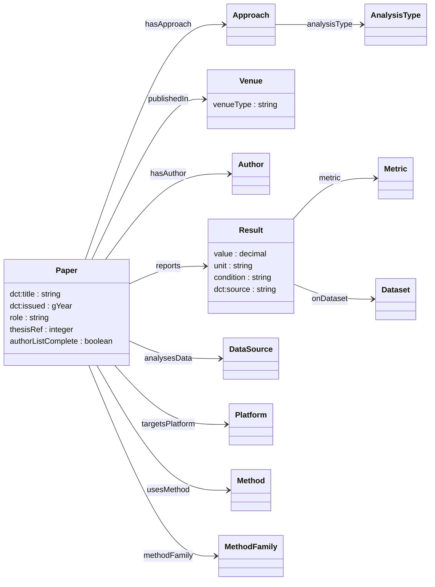
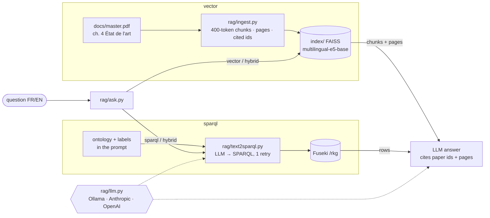
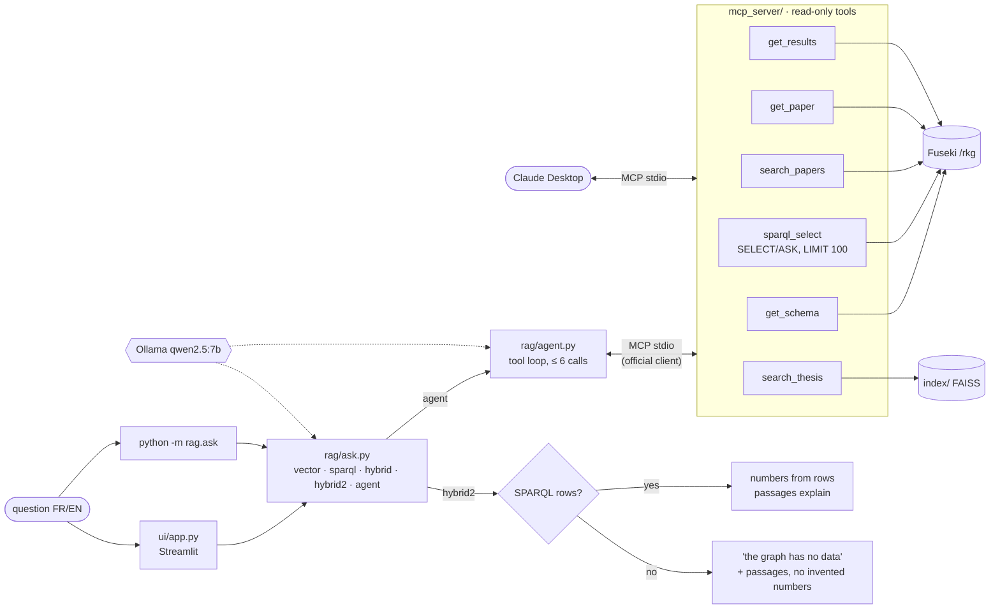

# ransomware-kg

A small knowledge graph of ransomware-detection research, built from the
literature review of my master's thesis. **Phase 1** covers the ontology, the
CSV → RDF pipeline with SHACL validation, a Fuseki triple store and a set of
example SPARQL queries. **Phase 2** adds question answering over the graph and
the thesis text (vector, text-to-SPARQL and hybrid RAG) plus a small benchmark.
**Phase 3** exposes the graph and the thesis index as a read-only **MCP server**,
adds an **agent** mode and a stricter **hybrid2** mode, a **Streamlit UI**, and
measures everything on the original questions and on a held-out set.

## Goal

The literature review compares about twenty papers, along with the results they
report. Spreadsheets are fine for listing them but awkward for questions that
cross several dimensions, such as *"which methods are used on Windows?"* or
*"how does my model compare with DeftPunk on the DeftPunk dataset?"*. The graph
turns the two hand-curated tables into linked, queryable data:

- `data/papers.csv`: one row per paper (authors, venue, approach, data
  sources, platforms, methods, method family, role in the review)
- `data/results.csv`: one row per reported number (metric, value, unit,
  dataset, condition, source table)

Nothing is inferred or invented. Every triple comes from a cell of these two
files.

## Ontology

Namespace `https://w3id.org/rkg#` (`ontology/rkg.ttl`). It reuses Dublin Core
(`dct:title`, `dct:issued`, `dct:source`, `dct:creator`, `dct:isPartOf`), BIBO
(`bibo:Document`), FOAF and schema.org (`Person`, `ScholarlyArticle`,
`Dataset`, `value`, `unitText`).



All entities other than papers and results have exactly one `rdfs:label`.

### Modelling choices

- **URIs** are stable: papers and results use the CSV ids
  (`…/id/paper/kebbas2025`, `…/id/result/kebbas2025-accuracy-deftpunk`).
  Everything else uses a slug of its label (`…/id/method/random-forest`,
  `…/id/platform/windows`), so the same label always gives the same node.
- **Lists** are cells split on `;`. Semicolons inside parentheses are kept,
  so `memory artifacts (processes; DLLs; injections)` stays one data source.
- **"et al."** author lists only produce the named author(s), and the paper is
  marked `rkg:authorListComplete false`.
- **Venues** are normalised: `IEEE Access 13` becomes venue `IEEE Access` plus
  `bibo:volume "13"`, `Sensors 25(8)` adds `bibo:issue "8"`, the edition year
  is dropped from conference names (`OSDI 2024` → `OSDI`), and arXiv ids go to
  `bibo:identifier`.
- **Method family** belongs to the paper, not to the method. Random Forest is
  "ML" in Aljabri et al. but part of a "hybrid" pipeline in ERW-Radar.

### SHACL shapes (`shapes/rkg-shapes.ttl`)

- A Paper has exactly one title, one `xsd:gYear` year, one venue and one role
  from a fixed list, plus at least one author.
- A Result has exactly one Metric, exactly one `xsd:decimal` value, and is
  reported by exactly one Paper. It has at most one dataset.
- An Approach has exactly one AnalysisType (static or dynamic).
- Every named entity has exactly one `rdfs:label`.

`build_graph.py` exits with an error and writes nothing if validation fails.

## How to run

Requirements: Python 3.10+, Docker, `make`, `curl`.

```sh
make build      # CSV -> data/graph.ttl, validated with pySHACL (creates .venv on first run)
make validate   # re-check data/graph.ttl against the shapes
make test       # 3 small pytest checks
make up         # start Fuseki on http://localhost:3030 (TDB2 dataset "rkg", Docker volume)
make load       # PUT ontology + graph into named graphs (idempotent)
make query      # run every query in queries/, or one: make query QUERY=queries/05-*.rq
make down       # stop Fuseki (data kept); `make clean` also deletes the volume
```

Fuseki runs as `secoresearch/fuseki:5.1.0` (Apache Jena Fuseki 5.1.0, built for
both amd64 and arm64) with the service config in `fuseki/rkg.ttl`. The ontology
and the data go into two named graphs, and the default graph is their union, so
queries don't need `GRAPH` clauses. Endpoints:

- SPARQL: `http://localhost:3030/rkg/sparql`
- Graph Store: `http://localhost:3030/rkg/data`
- Admin UI: `http://localhost:3030` (user `admin`, password
  `$FUSEKI_ADMIN_PASSWORD`, default `admin`)

## Queries

| File | Question |
|---|---|
| `01-best-accuracy-per-method-family.rq` | Best reported accuracy per method family |
| `02-dynamic-vs-static.rq` | Detection approaches grouped by static/dynamic analysis |
| `03-papers-using-io-data.rq` | Papers whose detector consumes I/O data |
| `04-methods-on-windows.rq` | Methods used by Windows-targeting papers |
| `05-kebbas-vs-deftpunk.rq` | My work vs DeftPunk on the DeftPunk dataset |
| `06-surveys-and-foundations.rq` | Surveys and foundational method papers |
| `07-papers-per-year.rq` | Papers per year (all / detection) |
| `08-authors-with-several-papers.rq` | Authors appearing on more than one paper |

### Example: my work vs DeftPunk (`queries/05-kebbas-vs-deftpunk.rq`)

```sparql
SELECT ?metric ?kebbas2025 ?deftpunk
WHERE {
  ?ds a rkg:Dataset ; rdfs:label "DeftPunk" .
  { SELECT DISTINCT ?m WHERE { ?r rkg:onDataset/rdfs:label "DeftPunk" ; rkg:metric ?m } }
  ?m rdfs:label ?metric .
  OPTIONAL {
    <https://w3id.org/rkg/id/paper/kebbas2025> rkg:reports ?r1 .
    ?r1 rkg:onDataset ?ds ; rkg:metric ?m ; rkg:value ?kebbas2025 .
  }
  OPTIONAL {
    <https://w3id.org/rkg/id/paper/wang2024deftpunk> rkg:reports ?r2 .
    ?r2 rkg:onDataset ?ds ; rkg:metric ?m ; rkg:value ?deftpunk .
  }
}
ORDER BY ?metric
```

Output from `make query QUERY=queries/05-kebbas-vs-deftpunk.rq`:

```
---------------------------------------
| metric      | kebbas2025 | deftpunk |
=======================================
| "accuracy"  | 92.87      |          |
| "f2_score"  | 75.97      |          |
| "precision" | 70.75      | 95.8     |
| "recall"    | 77.41      | 100.0    |
| "roc_auc"   | 95.95      |          |
---------------------------------------
```

DeftPunk's recall is recorded with the condition "approximately (~100%)" in
`results.csv`. The query can return the `rkg:condition` column if you need it.

### Example: best accuracy per method family (`queries/01-best-accuracy-per-method-family.rq`)

```
-----------------------------------------
| family   | paper           | accuracy |
=========================================
| "ML"     | "scalas2019"    | 99.6     |
| "hybrid" | "maazalahi2024" | 99.5     |
| "DL"     | "moreira2023"   | 98.2     |
-----------------------------------------
```

The heuristic and LLM families don't appear because none of their papers
reports an accuracy. UNVEIL reports TPR/FPR and SRDC reports a zero-day
improvement. These accuracies come from different datasets and are not directly
comparable.

## Known limitations (phase 1)

- Query 08 currently returns no rows. No author appears twice in
  `papers.csv`, and "et al." entries hide co-authors.
- Only one dataset (DeftPunk) is named in `results.csv`.

## Phase 2: question answering



- **Ingest** (`rag/ingest.py`) finds the "État de l'art" chapter in the
  PDF outline (falling back to page headings, or `--pages`). It strips running
  headers and cuts the text into ~400-token chunks with 80 tokens of overlap.
  Each chunk keeps its printed page numbers and the paper ids whose
  `ref_master` matches a `[n]` citation in it. Chunks are embedded with
  `intfloat/multilingual-e5-base` and stored in a FAISS index.
- **LLM** (`rag/llm.py`): Ollama `qwen2.5:7b` by default. Set
  `LLM_PROVIDER=anthropic|openai` in `.env` (see `.env.example`) and install
  that provider's SDK.
- **Text-to-SPARQL** (`rag/text2sparql.py`): the prompt holds the prefixes, the
  ontology's classes and properties, every label in the graph and the paper
  list, plus three generic examples. The query runs on Fuseki and is retried
  once with the parser error if it fails.
- **Ask** (`rag/ask.py`): `vector` answers from chunks, `sparql` from query
  rows, and `hybrid` from both. The answer must cite paper ids and thesis pages.

### How to run phase 2

```sh
pip install -r requirements-rag.txt        # into .venv
brew install ollama && ollama pull qwen2.5:7b
cp .env.example .env                       # optional: switch provider/model
cp /path/to/thesis.pdf docs/master.pdf     # git-ignored
make up load                               # Fuseki with the graph
make ingest                                # -> index/ (git-ignored)
.venv/bin/python -m rag.ask "Combien d'articles ciblent Windows ?" --mode hybrid --show-context
make bench                                 # -> results/benchmark.md
```

### Benchmark (phase 2)

`bench/questions.yaml` holds 15 questions (10 EN, 5 FR): 5 factual, 4
counting, 3 comparison and 3 "why". Each one's expected values can be checked
in the CSVs. An answer is **correct** when every expected value appears in it
(numbers match with `.` or `,`). It counts as **cited** when it cites a paper
id or thesis page that was actually in its context.

Run on 2026-11-19 with Ollama `qwen2.5:7b` on an Apple-silicon Mac (full
per-question table in [results/benchmark.md](results/benchmark.md)):

| Mode | Accuracy | Answers with citations | Avg latency (s) |
|---|---|---|---|
| vector | 27% (4/15) | 93% | 15.3 |
| sparql | 40% (6/15) | 7% | 11.7 |
| hybrid | 47% (7/15) | 87% | 25.5 |

| Type | vector | sparql | hybrid |
|---|---|---|---|
| factual (5) | 20% | 60% | 40% |
| counting (4) | 0% | 50% | 25% |
| comparison (3) | 33% | 33% | 67% |
| why (3) | 67% | 0% | 67% |

What the failures show:

- **sparql** is best at lookups and counts, but it depends on a 7B model
  writing valid SPARQL. 2 of 15 queries still failed to parse after the retry,
  and several ran but returned nothing useful. With no rows, the model
  sometimes invents a number (98,7% instead of 95.8 for q02). Its citation rate
  is low partly because count and value queries return no paper ids to cite.
- **vector** cannot count or aggregate, and chapter 4 never discusses
  `kebbas2025` (the paper has no `ref_master`). It wins on the "why"
  questions, whose reasons are written out in the thesis text.
- **hybrid** combines the strengths of both, but often **ignores correct graph
  rows** when text chunks are also present. On q01, q08 and q09 the right value
  (92.87, 9, 7) was in the context and the answer contradicted it. Possible next
  steps: a stronger model (`LLM_PROVIDER=anthropic`), putting the graph facts
  last and making them mandatory, or answering numeric questions straight from
  the rows.

## Phase 3: MCP server, agent, hybrid2, UI



### MCP server (`mcp_server/`)

Built with the official MCP Python SDK. In SDK 2.x the high-level API formerly
called `FastMCP` is named `MCPServer`; it's the same thing, and this repo uses
`mcp==2.3.0`. It runs over stdio and every tool is annotated
`readOnlyHint: true`:

| Tool | What it does |
|---|---|
| `get_schema()` | prefixes, classes, properties (domain → range), the exact labels in the graph, roles, paper list |
| `sparql_select(query)` | parsed with rdflib first. Only `SELECT`/`ASK` are accepted; SPARQL Update, `CONSTRUCT` and `DESCRIBE` are rejected. A `SELECT` without `LIMIT` gets `LIMIT 100` |
| `search_papers(text)` | papers matching the most words (title, authors, venue, approach, methods, data, platform) |
| `get_paper(id)` | full record of one paper, including its results |
| `get_results(paper_id?, metric?, dataset?)` | filtered results with unit, condition and source table |
| `search_thesis(query, k)` | passages from the thesis chapter with printed pages and cited paper ids |

Values passed to the tools are validated (paper ids must be `[a-z0-9]+`) or
escaped as SPARQL literals, so they cannot inject SPARQL.

```sh
make mcp     # = .venv/bin/python -m mcp_server  (stdio; needs `make up load`, `make ingest` for search_thesis)
```

**Claude Desktop:** add this to `~/Library/Application Support/Claude/claude_desktop_config.json`
(Windows: `%APPDATA%\Claude\claude_desktop_config.json`), using absolute
paths, then restart Claude Desktop:

```json
{
  "mcpServers": {
    "ransomware-kg": {
      "command": "/path/to/ransomware-kg/.venv/bin/python",
      "args": ["/path/to/ransomware-kg/mcp_server/server.py"],
      "env": { "FUSEKI_URL": "http://localhost:3030" }
    }
  }
}
```

The server finds the repo from its own path, so it doesn't depend on Claude
Desktop's working directory. Fuseki has to be running (`make up`).

### New answer modes

- **agent** (`rag/agent.py`) starts the MCP server as a subprocess and talks
  to it through the official MCP client. qwen2.5:7b calls the tools through
  Ollama's tool calling. After 6 tool calls the tools are withdrawn and the
  model must write its answer, citing paper ids and pages. The UI and
  `--show-context` list every tool call. Agent mode works with
  `LLM_PROVIDER=ollama` only for now.
- **hybrid2** (in `rag/ask.py`; `hybrid` is unchanged). The design comes from
  the phase 2 error analysis, where hybrid often ignored correct graph rows:
  - **When the SPARQL query returns rows:** the rows go last in the prompt and
    count as ground truth for every number, and the passages only explain. A
    deterministic check follows. If the answer doesn't contain the row's
    numbers (all of them for a single-row count or value, at least one for a
    list), the rows are stated first ("Knowledge graph: count = 9").
  - **When it returns no rows:** the answer starts with a fixed sentence, "The
    knowledge graph has no data for this question." / "Le graphe de
    connaissances ne contient pas de données…". The model then sees only
    passages, and any sentence giving a decimal or a percentage that no passage
    contains is removed.

### UI

```sh
make ui      # = .venv/bin/streamlit run ui/app.py  → http://localhost:8501
```

The UI has a question box, a mode selector, the answer, and the sources: cited
paper ids with their titles, and cited thesis pages. A ⚠️ marks any citation
that wasn't in the model's context. Expanders show the generated SPARQL with
its rows, the agent's tool calls, and the retrieved passages.

### Benchmark (phase 3)

Run once on 2026-11-19 with Ollama `qwen2.5:7b`. Scoring is the same as in
phase 2. Per-question tables are in [results/benchmark.md](results/benchmark.md).

**Original 15 (used for error analysis)**

| Mode | Accuracy | Answers with citations | Avg latency (s) |
|---|---|---|---|
| vector | 27% (4/15) | 93% | 14.3 |
| sparql | 40% (6/15) | 7% | 12.6 |
| hybrid | 47% (7/15) | 87% | 24.5 |
| hybrid2 | 53% (8/15) | 80% | 30.9 |
| agent | 67% (10/15) | 60% | 6.6 |

**Held-out 10 (never used for tuning)**

| Mode | Accuracy | Answers with citations | Avg latency (s) |
|---|---|---|---|
| vector | 80% (8/10) | 100% | 15.2 |
| sparql | 40% (4/10) | 20% | 9.2 |
| hybrid | 80% (8/10) | 90% | 21.6 |
| hybrid2 | 90% (9/10) | 90% | 23.1 |
| agent | 30% (3/10) | 50% | 9.0 |

Honest notes:

- **The agent doesn't generalise.** It was best on the original set (67%)
  and worst on the held-out set (30%). It nearly always makes a single tool
  call and invents paper ids (`aljabri2024memory`, `scalas2023android`)
  instead of looking them up with `search_papers`. It then reports "no data"
  when the result comes back empty. Part of its original-set score comes from
  a fix I made while testing on q08: `search_papers` now ranks partial matches
  instead of requiring every word. That fix was informed by the original set,
  and the held-out set shows it doesn't carry over. A 7B model doesn't plan
  multi-step tool use reliably; a stronger model is the obvious next test.
- **hybrid2 does what it was built for.** On the original set it fixed the
  three phase 2 failures where hybrid ignored correct rows (q01, q08, q09), and
  it was the best mode on the held-out set (9/10). Its weak point is that it
  trusts the rows: on h05 the generated SPARQL was wrong and returned
  `count = 0`, and that 0 was enforced.
- **The two sets are not equally hard.** Vector-only scores 80% on the
  held-out set but 27% on the original. Most held-out values and "why" answers
  are written out in chapter 4, while the original set has more counting and
  cross-paper questions, which only the graph can answer. With 10 and 15
  questions, one run, and a model whose wording changes between runs, a
  difference of one or two questions is noise.
- **The phase 2 modes reproduced exactly** (vector 4, sparql 6, hybrid 7 out
  of 15), so the phase 3 refactor didn't change their behaviour.
- **I saw the held-out questions before building phase 3.** You pasted the
  file for me to commit, and it was committed (`7edfedc`) before any phase 3
  code. No prompt, rule, example or tool was designed from those questions,
  and nothing was changed after seeing the held-out results.
